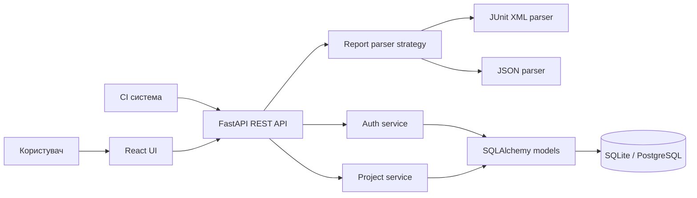
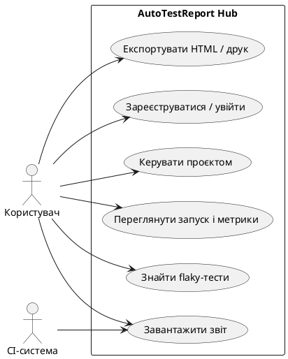
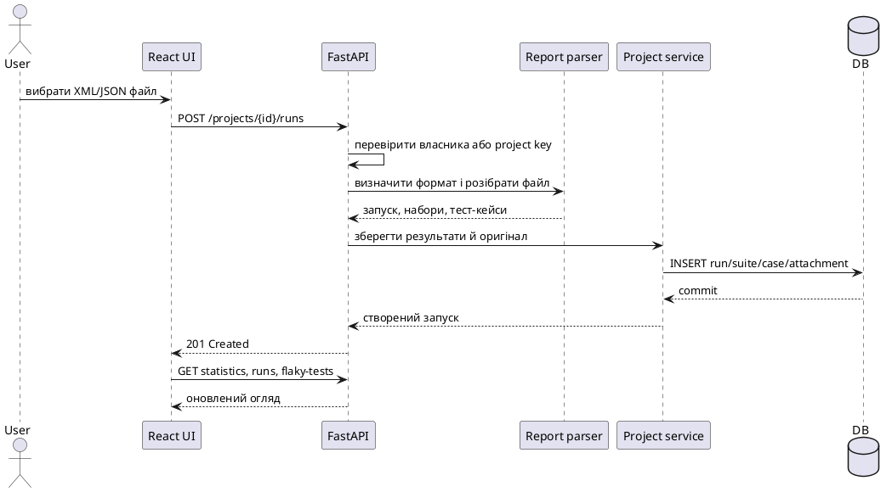
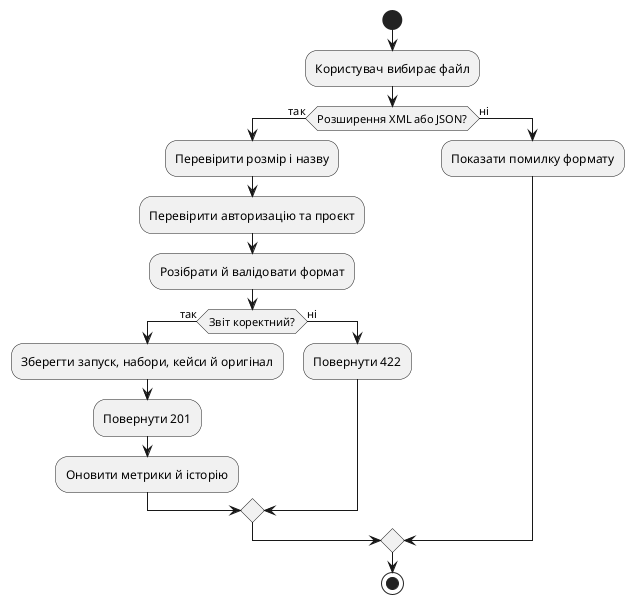
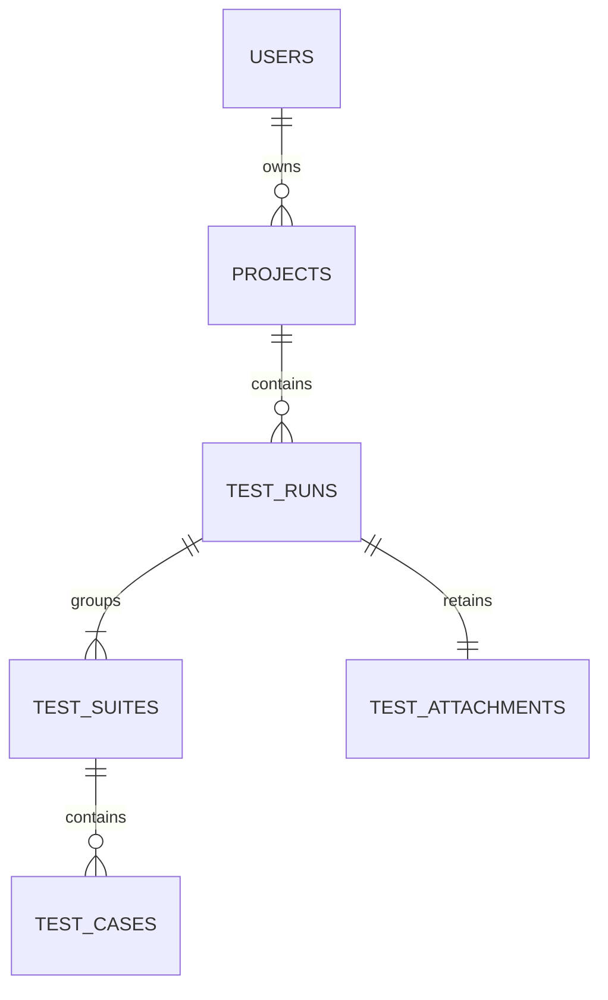

# Проєктування AutoTestReport Hub

## Призначення та межі

AutoTestReport Hub збирає результати автоматизованих тестів із JUnit XML або JSON, зберігає запуски, показує метрики якості та формує HTML-звіт. PDF-сценарій використовує підготовлену до друку HTML-сторінку й діалог браузера «Save as PDF»; окремий серверний PDF-генератор не використовується.

Предметна область — керування тестовими запусками програмних проєктів. Основні користувачі — розробник або QA-інженер, який переглядає результати, та CI-система, яка завантажує звіти з використанням ключа проєкту. Система не запускає тести сама: вона імпортує та аналізує вже сформовані файли звітів.

## Функціональні вимоги продукту

| ID | Вимога |
|---|---|
| FR-01 | Користувач може зареєструватися, увійти та переглянути власний профіль. |
| FR-02 | Користувач може створити, переглянути, перейменувати та видалити власний проєкт. |
| FR-03 | Користувач може імпортувати JUnit XML або JSON-звіт до власного проєкту. |
| FR-04 | Система зберігає оригінальний файл звіту та структуровані дані запуску, наборів і тестів. |
| FR-05 | Система обчислює кількості passed/failed/skipped і pass rate; skipped не входять до знаменника pass rate. |
| FR-06 | Користувач може переглянути історію запусків і деталі тест-кейсів. |
| FR-07 | Система позначає тест flaky, якщо той самий клас і назва тесту мали passed та failed у різних запусках. |
| FR-08 | Користувач може завантажити автономний HTML-звіт або відкрити підготовлений до друку звіт. |
| FR-09 | Користувач може переглядати лише власні проєкти й пов’язані результати. |

## Користувацькі історії

| Роль | Потреба | Цінність |
|---|---|---|
| Розробник | Завантажити CI-звіт у проєкт | Переглядати зміни якості між запусками |
| QA-інженер | Бачити помилки, пропуски та flaky-тести | Швидше знаходити нестабільні перевірки |
| Власник проєкту | Керувати проєктом і доступом | Ізолювати результати різних продуктів |
| CI-система | Завантажувати звіт із ключем проєкту | Передавати результати без ручного входу користувача |

## Нефункціональні вимоги та перевірка

| ID | Вимога / реалізоване обмеження | Перевірка або межа доказу |
|---|---|---|
| NFR-01 | Паролі хешуються Argon2id; API використовує короткоживучий bearer token. | Підтверджено реалізацією та тестами авторизації. |
| NFR-02 | Дані проєктів ізольовані за власником; чужий ресурс повертає 404. | Є тест доступу між власниками. |
| NFR-03 | Імпорт обмежено 10 MiB і 10 000 тест-кейсами; XML DTD/entity відхиляються. | Позитивні та негативні API-тести; повне навантажувальне тестування не виконувалось. |
| NFR-04 | Вхідні дані перевіряються Pydantic-схемами та парсерами звітів. | API/unit-тести; некоректні звіти повертають 422. |
| NFR-05 | Сховище за замовчуванням SQLite; URL БД налаштовується через DATABASE_URL; міграції керуються Alembic. | Сумісність із PostgreSQL задекларована архітектурою, але в цьому середовищі не перевірялась. |
| NFR-06 | Інтерфейс має адаптивну навігацію й прокручувані таблиці для вузьких екранів. | Перевірено настільний і вузький viewport; повна перевірка фізичних пристроїв не проводилась. |
| NFR-07 | Клієнтські запити асинхронні; стан завантаження й помилки показуються в інтерфейсі. | Перевірка користувацького потоку; мережеве навантаження не вимірювалось. |
| NFR-08 | Продуктивність, доступність і відновлення після відмови не мають підтверджених SLA. | Потрібні окремі вимірювання та політика резервного копіювання перед заявами про SLA. |

## Архітектура та взаємодія компонентів

Застосунок — модульний моноліт: React/TypeScript клієнт звертається до FastAPI через REST API; FastAPI використовує SQLAlchemy, сервіси предметної логіки та SQLite/PostgreSQL-сумісну схему. Parser Strategy розділяє обробку форматів JUnit XML та JSON. Компоненти рознесено за відповідальністю без окремих сервісів і черг, яких поточний обсяг задачі не потребує.



## UML-моделі

### Варіанти використання



### Модель класів предметної області

```plantuml
@startuml
class User {
  id: UUID
  email: string
  display_name: string
  hashed_password: string
  is_active: bool
}
class Project {
  id: UUID
  owner_id: UUID
  name: string
  description: string?
  api_key_hash: string
}
class TestRun {
  id: UUID
  project_id: UUID
  report_format: string
  branch: string
  status: string
  total_tests: int
  pass_rate: float
}
class TestSuite { id: UUID; run_id: UUID; name: string }
class TestCase { id: UUID; suite_id: UUID; classname: string; name: string; status: string }
class TestAttachment { id: UUID; run_id: UUID; filename: string; content: bytes }
User "1" -- "0..*" Project : owns
Project "1" -- "0..*" TestRun : contains
TestRun "1" -- "1..*" TestSuite : groups
TestSuite "1" -- "0..*" TestCase : contains
TestRun "1" -- "1" TestAttachment : retains source
@enduml
```

### Послідовність імпорту звіту



### Діяльність імпорту звіту



## Дані та реляційна схема



| Таблиця | Первинний ключ | Основні поля та обмеження |
|---|---|---|
| users | id | email UNIQUE, display_name, hashed_password, is_active, timestamps |
| projects | id | owner_id FK, name, description, api_key_hash UNIQUE; UNIQUE(owner_id, name) |
| test_runs | id | project_id FK, source_filename, формат/гілка/статус/метрики; CHECK невід’ємних лічильників і pass_rate 0..100 |
| test_suites | id | run_id FK, name |
| test_cases | id | suite_id FK, classname, name, статус із дозволеного переліку, duration >= 0 |
| test_attachments | id | run_id UNIQUE FK, filename, content_type, size_bytes, оригінальні bytes |

Зв’язки реалізовані зовнішніми ключами з каскадним видаленням дочірніх даних. Дані запуску, набору, тест-кейсу та вкладення винесені в окремі таблиці; повторювані значення не дублюються між рівнями, що відповідає 3NF для наявних атрибутів. Міграції є джерелом фактичної схеми. SQLite вмикає контроль зовнішніх ключів.

## Навігація та wireframe

Основні екрани: реєстрація/вхід; огляд вибраного проєкту; список запусків; деталі запуску; список flaky-тестів; створення/редагування проєкту. Основний сценарій: обрати проєкт → імпортувати звіт → переглянути метрики/історію → відкрити деталі або flaky-результат → експортувати звіт.

```text
Desktop
┌────────────────┬────────────────────────────────────────────┐
│ Brand / nav     │ Project, refresh, HTML, print, upload       │
│ Projects        ├────────────────────────────────────────────┤
│ Profile         │ Metrics: runs / pass rate / failed / flaky │
│                │ Quality trend          Test summary          │
│                │ Recent runs table      Flaky preview         │
└────────────────┴────────────────────────────────────────────┘

Mobile
┌──────────────────────────────────────┐
│ Project / refresh / export / upload  │
│ Metrics (two columns)                │
│ Quality trend                        │
│ Test summary                         │
│ Recent runs (table scrolls sideways) │
├──────────────────────────────────────┤
│ Overview        Runs        Flaky     │
└──────────────────────────────────────┘
```

## API-контракт

| Метод | Endpoint | Призначення | Основні відповіді |
|---|---|---|---|
| POST | /api/v1/auth/register | Створити акаунт | 201, 409, 422 |
| POST | /api/v1/auth/login | Увійти | 200, 401, 422 |
| GET | /api/v1/auth/me | Профіль поточного користувача | 200, 401 |
| GET/POST | /api/v1/projects | Список / створення проєктів | 200, 201, 401, 409, 422 |
| GET/PUT/PATCH/DELETE | /api/v1/projects/{id} | Прочитати / повністю замінити / частково змінити / видалити проєкт | 200, 204, 401, 404, 409, 422 |
| POST | /api/v1/projects/{id}/runs | Імпортувати звіт | 201, 401, 404, 413, 422 |
| GET | /api/v1/projects/{id}/runs | Історія запусків | 200, 401, 404, 422 |
| GET | /api/v1/projects/{id}/statistics | Метрики проєкту | 200, 401, 404 |
| GET | /api/v1/projects/{id}/flaky-tests | Flaky-тести | 200, 401, 404 |
| GET | /api/v1/runs/{id} | Деталі запуску | 200, 401, 404 |

FastAPI/Pydantic повертає 422 для помилок валідації; невідомий або недоступний власнику ресурс повертає 404, щоб не розкривати чужі ідентифікатори. 500 залишається загальним статусом неочікуваної серверної помилки. 400 та 403 не призначені для окремих поточних сценаріїв.

## Перевірки та межі висновку

Функціональні сценарії, unit-тести парсерів і DB/API integration-тести описані в [TEST_CASES.md](../tests/TEST_CASES.md). Результат останнього запуску слід брати лише з фактичного актуального виконання тестів; попередні результати в цьому документі не є доказом нового запуску.

Перевірка реального інтерфейсу та синтетичні тестові записи не є навантажувальним тестом або доказом резервного відновлення. Git-історія, знімки екрану фізичного мобільного пристрою та фактичний PDF-файл мають долучатися лише після відповідного виконання.
